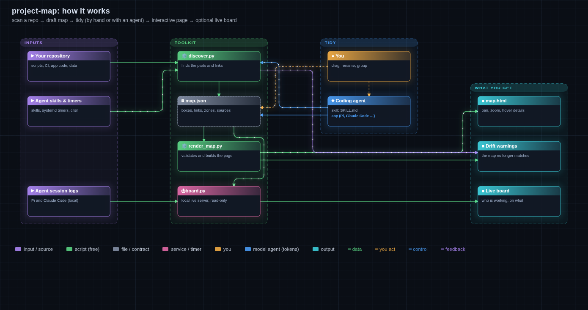
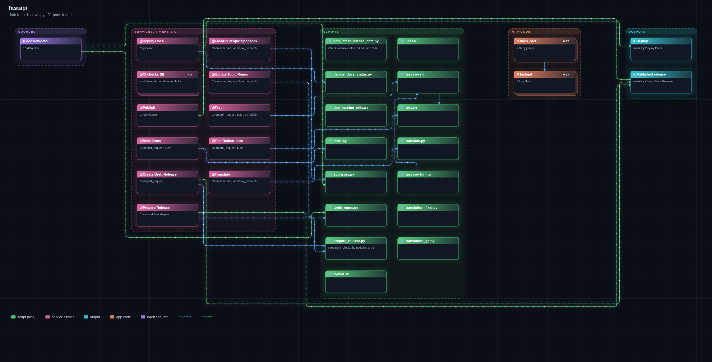

# project-map

**Point it at a repository and get an interactive architecture map:** where data comes from, which scripts, CI jobs,
timers and app modules process it, which AI agents and people are involved, what they hand each other, and what
comes out. Optionally, a local live board shows which agent is working and on what.



- **Automatic.** `discover.py` scans the repository and drafts the map. No configuration needed.
- **Yours to tidy.** The map is a plain `map.json`; rename, regroup and move boxes by hand, or let a coding agent do it with the included skill.
- **Stays true.** Each box remembers the files it came from. When scripts or workflows appear or disappear, the map says it is out of date and `--update` adds the new parts.
- **Works anywhere.** The output is one HTML file: open it in any browser, drag to move, pinch or Ctrl+scroll to zoom, press `/` to search. It works on phones too.
- **Light.** Python 3.10+ standard library only. No dependencies, no build step, and nothing leaves your machine.

## Quick start

```bash
git clone https://github.com/perweum/project-map
cd project-map
python3 discover.py ~/code/my-project -o ~/agent-maps/my-project/map.json
python3 render_map.py ~/agent-maps/my-project/map.json
# open ~/agent-maps/my-project/map.html in a browser
```

This is what the raw draft looks like for [fastapi/fastapi](https://github.com/fastapi/fastapi), straight from
`discover.py` with no edits. It shows CI workflows calling scripts, the app packages, and what gets deployed and released:



## What it finds

| | |
|---|---|
| Scripts and commands | `tools/`, `scripts/`, `bin/` …, `package.json` scripts, Makefile and justfile targets, with each script's docstring |
| CI and services | GitHub/GitLab workflows and their triggers, docker-compose services, systemd user timers and cron jobs that run the project |
| App code | top-level packages and entry points, and which imports which |
| Agents | agent skills in the repo (`.agents/skills`, `.claude/skills`, `.pi/agents` …) and your own skills that mention the project, which skill hands work to which, and the folders they pass files through |
| Inputs | data folders the scripts read, hosts and git repositories they fetch from |
| Outputs | files marked "generated by …", releases and deployments |

Large projects stay readable: script families (`gen_*.py`), sub-folders and rarely used scripts are merged into one box each.

**Zoom into a box.** Merged boxes and app folders carry an inner map; they look like a stack of cards with a count (⧉ 11).
Open one with a second click, a double-click, Enter, or **Open** in its toolbar to see its parts: the scripts in a family with the outside boxes each one reads or feeds (dashed), or the files and sub-folders of an app
folder and which imports which. A breadcrumb (or Backspace) takes you back out. Inner maps can be nested, and you can write
your own with an `inner` field on any box.

## Using the page

| Gesture | Does |
|---|---|
| Hover | preview: its connections light up |
| Click / tap | select: a ring and a toolbar with **Open** (boxes with an inside) and **Details** |
| Details | a drawer with the description, live status, what it gets from and feeds into (click to jump), and its source files. It follows your selection until you close it |
| Click again, double-click, Enter | the main action: open a box that has an inside, otherwise show its details |
| Drag the canvas, pinch, Ctrl+scroll | move and zoom |
| `/` | search; Enter jumps from hit to hit |
| Legend entries | click a kind (script, input …) or link type to show only those; click more to add, "show all" to reset |
| Esc, Backspace | close the drawer, deselect, go back out |

## Keeping a map up to date

```bash
python3 discover.py ~/code/my-project --check  map.json   # what is new, what is gone (exit 1 = out of date)
python3 discover.py ~/code/my-project --update map.json   # add new parts, mark gone ones; moves nothing
python3 discover.py ~/code/my-project --baseline map.json # accept what is left out on purpose
```

The rendered page shows a red **map out of date** badge, and boxes whose files are gone get a dashed red outline.
Running `--check` in CI keeps a committed map honest.

## Using it with a coding agent

`SKILL.md` follows the [Agent Skills](https://agentskills.io) format. Link this folder into your agent's skills folder:

```bash
ln -s "$PWD" ~/.claude/skills/project-map      # Claude Code
ln -s "$PWD" ~/.pi/agent/skills/project-map    # Pi
ln -s "$PWD" ~/.agents/skills/project-map      # other agents that read ~/.agents/skills
```

Then ask "make a project map" in any repository. The agent runs `discover.py`, then names things, merges noise,
adds what a script cannot see (people, approvals, external inputs) and writes a short description for every box.

## Live board

```bash
python3 board.py --open     # starts the board (unless it already runs) and opens http://127.0.0.1:8765/ in your browser
python3 board.py --open my-project   # straight to one map
```

On the live board, the **LIVE** chip opens the activity feed in the drawer; click a line to jump to that box.
A saved `map.html` shows **Live view →** instead: it goes straight to the live map when the board runs, and otherwise
shows the exact command to start it, with a copy button.

Add a `live` section to a map (`discover.py` drafts one) and boxes light up while work happens:

- agents from local Pi and Claude Code session logs: working or idle, the current tool call, an activity feed and today's estimated cost;
- files appearing in hand-over folders, and review verdicts;
- systemd timers (next run, last result; Linux only, on macOS those boxes stay blank), open git branches and running processes.

The board listens only on 127.0.0.1 and is read-only. It runs a fixed set of probes and never runs commands from a map.
It does its work only while a page is open, and redacts secret-looking text in the feed.
See `SKILL.md` for the `live` format.

## Map format

```json
{
  "version": 1, "title": "My project", "repo": "~/code/my-project",
  "nodes": [{"id": "gen", "x": 18, "y": 4, "kind": "script", "title": "build.py", "sub": "builds the site",
             "detail": "Shown on hover.", "source": ["tools/build.py"]}],
  "edges": [["gen", "site", "data"]],
  "groups": [{"label": "Build", "nodes": ["gen"], "kind": "script"}]
}
```

Any box can have an `inner` map (`nodes`, `edges`, optional `groups`; `x`/`y` optional, laid out automatically; `"outside": true` marks a box from the level above).
Node kinds are `input`, `script`, `service`, `module`, `agent`, `human`, `file` and `output`. Edge kinds are `data`, `control`, `human` and `feedback`.
`version` is the format version (currently 1); maps without it are read as version 1, and a renderer refuses maps newer than it understands.
`x`/`y` are grid units of 20 px. Wires are routed around boxes automatically. `render_map.py` rejects invalid maps with a list of problems.

## Roadmap

- [x] Automatic discovery, drift check, live agent board
- [x] Search box
- [x] Zoom into a box: sub-maps for app modules and merged script boxes, drafted automatically
- [ ] Screens & flows view for designers: each screen as a box with a screenshot thumbnail, links to design files
- [ ] Drag boxes to arrange them and save the layout from the page; sticky notes on the canvas
- [ ] Assets view: which images, fonts and icons a project uses and where they come from

Ideas and bug reports are welcome as issues.

## Tests

```bash
python3 -m unittest discover -s tests -v
```

## Licence

MIT, see [LICENSE](LICENSE).
